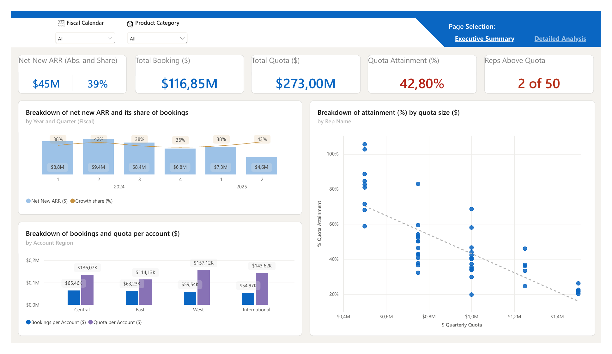
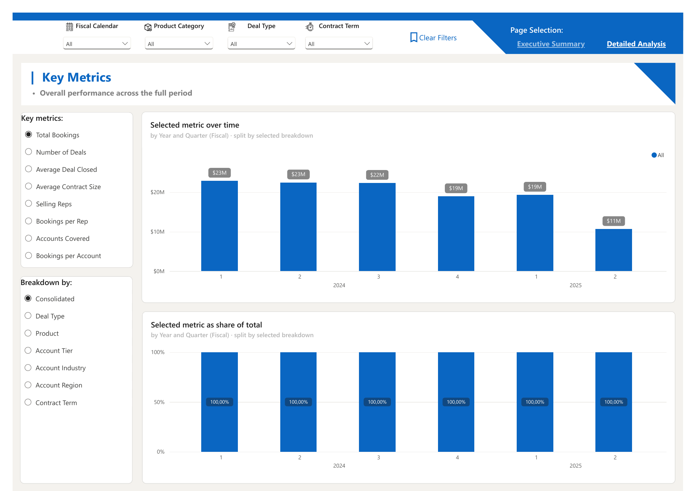
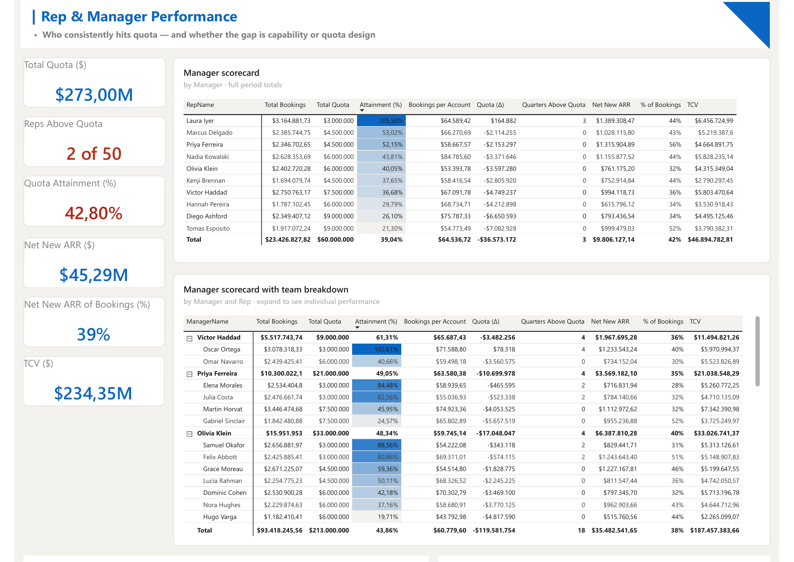
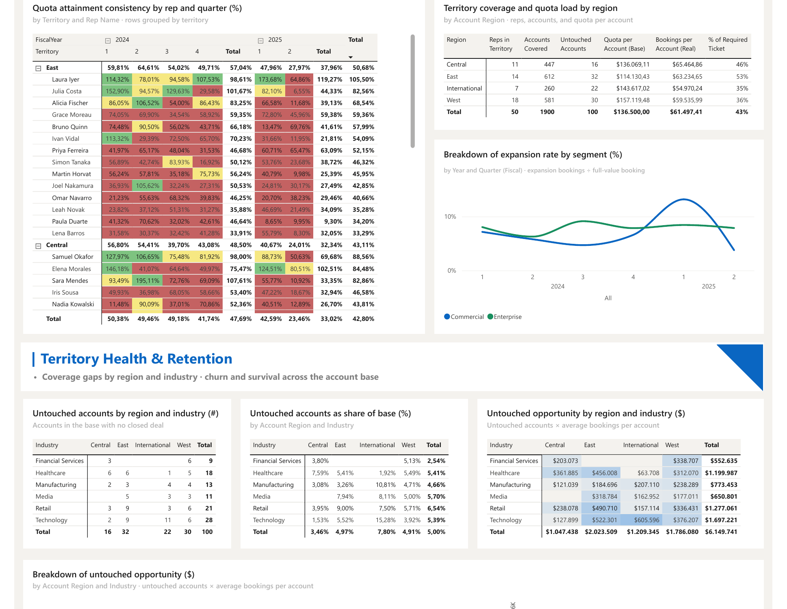
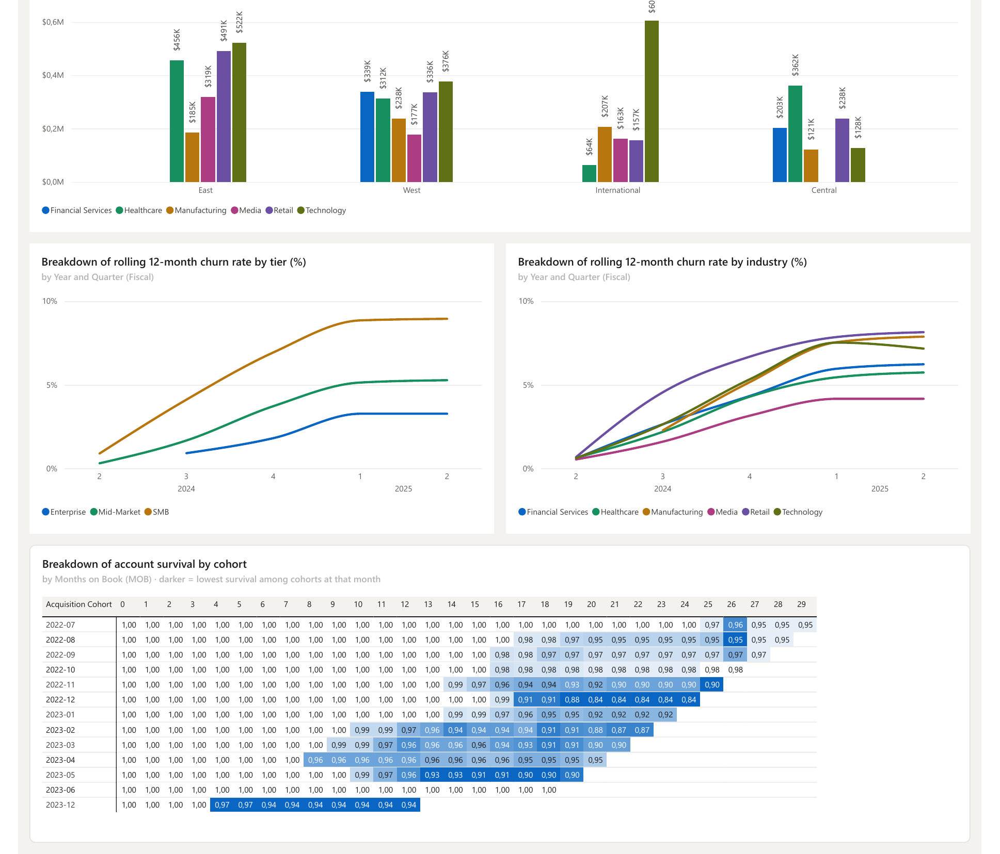
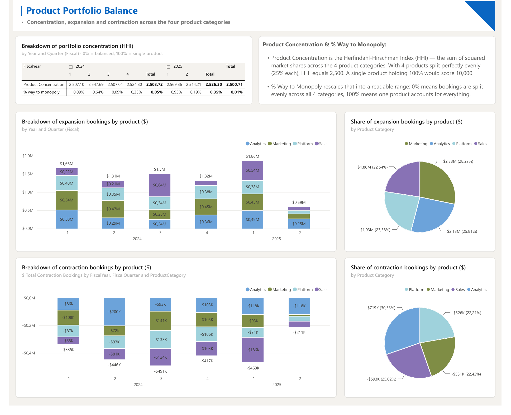

# Sales Performance Dashboard (Power BI)

A two-page Power BI report for the VP of Sales of a B2B SaaS company. It answers one question: when most reps miss quota, is the problem the territories or the quotas?

The data is synthetic. Every company, rep, ID and amount was generated by [`generate_data.py`](generate_data.py), so the project can be public without exposing anyone's data.

## The business question

The VP has 50 reps across four territories (West, East, Central, International) and 18 months of closed deals. Attainment is low. Before the next planning cycle she needs to decide between two options:

1. Redraw territories, because some reps may sit on weaker accounts.
2. Adjust quotas, because the targets may not match what the market can absorb.

The report gives her the numbers for that call on page 1 and the drill-down to defend it on page 2.

## What is in the report

| Page | Canvas | Purpose |
|---|---|---|
| Executive Summary | 1280 × 720, no scroll | 5 KPI cards and 3 visuals: Net New ARR by quarter, bookings vs quota per account by region, attainment vs quota size by rep |
| Detailed Analysis | 1280 × 5075, scroll | 4 sections: Key Metrics, Rep & Manager Performance, Territory Health & Retention, Product Portfolio Balance |

Page 2 includes:
- A metric explorer built with field parameters (7 measures × 7 breakdowns).
- A manager scorecard.
- Quota attainment by rep and quarter.
- Untouched accounts and untouched opportunity by region and industry.
- Rolling 12-month churn by tier and by industry.
- Account survival by cohort and months on book.
- Product concentration measured with the Herfindahl-Hirschman Index (HHI).

Detailed Analysis (5 screenshots, top to bottom)

## Data model

Star schema with one fact and three dimensions:

- `Sales Transactions` (fact): one row per closed-won deal.
- `Accounts`: customer, industry, tier, region, churn date.
- `Sales Reps`: territory, segment, hire date, quarterly quota, manager.
- `Date Table`: daily calendar with a fiscal year that starts on July 1 (FY2025 runs from Jul 2024 to Jun 2025).

Fiscal quarters line up with calendar quarters, so `DATESQTD` works as is and `DATESYTD` takes the `"6/30"` year-end argument.

**Two geographies, kept separate.** `Accounts[Region]` and `Sales Reps[Territory]` share the same four values but are not the same thing. About 20% of deals are closed by a rep from outside the account's region. A shared geography dimension would create an ambiguous filter path to the fact table, so the report uses two labeled slicers. No visual mixes both columns, except the intersection matrix, where the overlap is the point.

## The four core measures

**Net New ARR.** New Business + Expansion + Contraction, excluding Renewal, since a renewal does not grow the base. Contraction amounts are already negative in the source, so they are summed as they are. Flipping the sign would inflate the result. The filter removal uses `ALL('Sales Transactions'[DealType])` and not `ALL('Sales Transactions')`, which would also wipe date, region and rep filters.

**Quota Attainment %.** `QuarterlyQuota` is a static attribute with no time dimension. Summing it returns the same total for any period, so a full fiscal year would show close to 3× the real attainment. The measure builds the list of visible quarters at query time with `SUMMARIZE`, iterates it with `SUMX`, and adds the quota of each rep hired before that quarter started. `ALLEXCEPT` keeps the quarter filter and drops a month-level filter that would shift the quarter start date. The proper fix upstream is a quota fact table with one row per rep per quarter.

**Rolling 12-Month Churn Rate.** Two versions:
- *Spec*: churned in the window ÷ (active today + churned in the window).
- *Cohort*: counts only accounts that were already customers when the window opened. It is the stricter version, because the spec denominator dilutes the rate when acquisition is strong.

The cohort base needs an explicit `ISBLANK(ChurnDate)` test, or every live account drops out and the rate jumps to about 90%.

**Average Deal Size.** The required version is total bookings ÷ number of deals. It mixes two units: full contracts (New Business, Renewal) and deltas (Expansion, Contraction). The report adds `$ Average Contract Value` (full-value bookings only) and uses it in the trend charts. The measures keep numerator and denominator explicit rather than calling `AVERAGE()`, so each part can be checked on its own.

DAX validation queries for all four measures are in `sales_performance_dashboard.SemanticModel/DAXQueries`.

## Data quality checks

Row counts and the bookings control total were checked against the CSVs before any modeling. These issues are in the data on purpose. The report handles each one:

| Issue | Effect if ignored | How the report handles it |
|---|---|---|
| Last fiscal quarter (FY2025 Q2) is truncated: volume halves in November and almost stops in December | Any trend line shows a fake drop in the last quarter | Treated as a partial quarter, not read as a decline |
| `ChurnDate` only populated from December 2023 | Every cohort's first drop lands on the same month, which looks like a tenure effect | No cohort conclusion reported, since the pattern comes from the field, not from customer behavior |
| Static quarterly quota | Attainment inflates with period length | Quarter-by-quarter `SUMX` (see above) |
| Contraction already negative | Sign flip inflates Net New ARR | Summed as is |
| Trailing spaces in about 20% of account names | Duplicate-looking names in visuals | `Text.Trim` in Power Query |
| 100 accounts with no closed deal | Coverage looks complete | Tracked as untouched accounts and untouched opportunity |

## Design decisions

- Page 1 is a cockpit: one screen, no scroll, at most 8 visuals, wide view first and drill-down on page 2.
- Every chart title says what it breaks down and by what ("Breakdown of attainment (%) by quota size ($)"), with the dimension in the subtitle.
- One geography per visual (see Data model).
- Custom theme (`saas_sales_theme.json`), with the categorical palette checked for color-blind contrast.

## How to run it

1. Install Power BI Desktop (free, Windows).
2. Clone this repository.
3. Open `sales_performance_dashboard.pbip`.
4. Go to *Transform data > Edit parameters* and set `FolderPath` to the folder that holds the four CSVs, ending with a backslash. The default is `C:\sales-performance-dashboard\`, so cloning the repository to that path works without changes.
5. Click *Refresh*. Total bookings should read $116.8M.

To regenerate the data: `python generate_data.py` (Python 3, standard library only, fixed seed).

## Tools

Power BI Desktop (PBIP format), DAX, Power Query (M), Python for the data generator.
